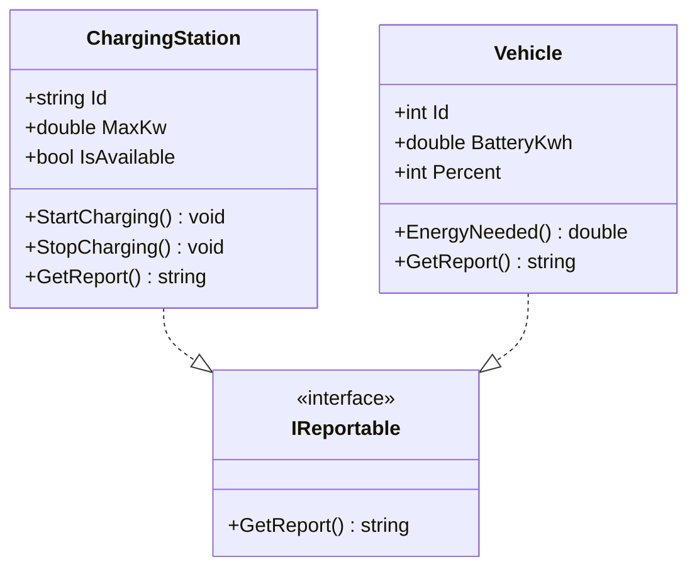

# ChargeHub.Stations

Detta program simulerar en laddstation (`ChargingStation`) och fordon (`Vehicle`) som båda implementerar interfacet `IReportable` för att kunna skriva ut statusrapporter. Programmet säkerställer även att en station har en giltig effekt (> 0 kW) och förhindrar att en ny laddning startas om stationen redan är upptagen.

## Hur man kör programmet
Öppna en terminal i projektmappen och kör:
```bash
dotnet run
```

## Klassdiagram

